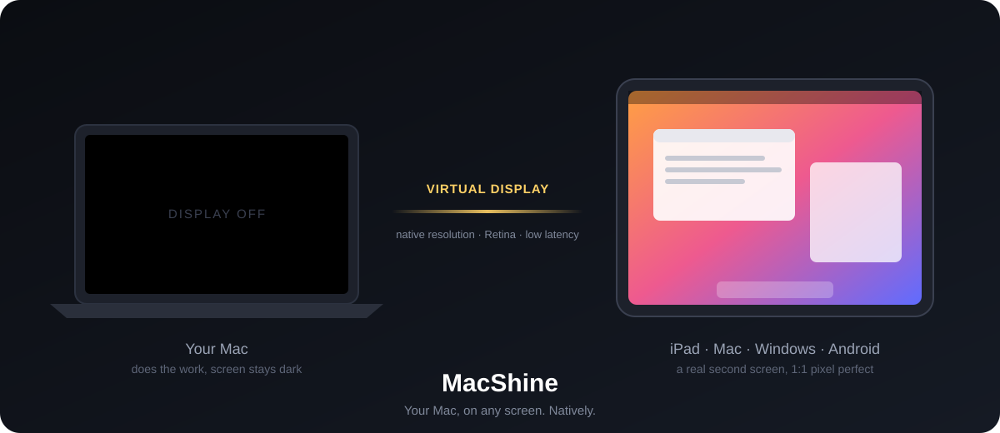

<div align="center">
  

  <h1>MacShine</h1>
  <h3>Your Mac, on any screen. Natively.</h3>
  <h4>🖥 Virtual displays for macOS, built right in.</h4>

  <p>
    MacShine turns your iPad, MacBook or Windows laptop into a real display for your Mac.<br/>
    Not a mirrored screen squeezed into the wrong shape, but a <b>virtual display made for the device you are holding</b>:
    its exact resolution, Retina sharp, color accurate and fast.<br/>
    🎙 Want to talk? Your device's microphone can come along too, if you want it.
  </p>

  <a href="https://github.com/gersiaaan/MacShine/releases/latest"></a>
  
  
  
</div>

---

## Why MacShine

Classic screen streaming captures the Mac's own monitor and squeezes it onto your tablet.
Wrong aspect ratio, black bars, blurry text, tiny UI.

**MacShine works the other way round.** When a device connects, your Mac creates a brand-new
display that exists only for that device, in exactly its resolution. macOS renders straight into it.
What you see on the iPad is the Mac's real desktop, pixel for pixel.

> ### ✨ Virtual display for macOS, all in one
> MacShine creates the virtual display **and** switches off your Mac's own screen, by itself, the moment you connect.
>
> - ❌ No HDMI dummy plug
> - ❌ No extra display server or driver to set up
> - ❌ No second app to juggle next to your streaming host
>
> Connect from your device, and your Mac's screen goes dark while your full desktop appears on the device in its native resolution.
> Disconnect, and everything comes back. That's it.

## Features

### 🖥 A display made for your device
- **Native resolution, 1:1.** Every device gets its own virtual display in its exact resolution. No scaling, no black bars.
- **Retina / HiDPI.** Text and UI are rendered at 2× and stay razor sharp, just like on a built-in Apple display.
- **Resize without blur.** Switch between "Larger Text" and "More Space" (75 – 200 %) in System Settings → Displays, live while streaming. The stream resolution stays the same, so it never gets soft. Your choice is remembered per device.
- **Full desktop.** Menu bar and Dock move onto the streamed display, so it feels like sitting in front of the Mac.
- **Remembers each device.** Every paired device gets a fixed display identity. macOS keeps its arrangement, size and window positions.
- **Seamless reconnect.** Drop the connection or switch apps: the display stays alive for 30 seconds, so your windows are still where you left them.

### ⚡ Low latency
- **ScreenCaptureKit capture** straight from the GPU, shared between streams.
- **Double refresh rate.** The virtual display renders at twice the stream rate (up to 120 Hz), so your input lands in the very next frame.
- **No frame held back.** Each frame is sent the moment it is ready, and host latency is reported to the client.
- **Smooth touchpad scrolling** with natural macOS-style gliding.

### 🎨 Color accurate
- The Mac captures in exactly the **color space and range the client asks for**, so colors arrive 1:1 instead of washed out or crushed.

### 🌑 Your Mac becomes a compute box
- **Host displays off.** While streaming, the Mac's own screens go dark (even mini-LED goes fully black). Open the lid mid-stream and it stays dark.
- **Local input locked.** The Mac's keyboard and trackpad are ignored while someone is connected.
- **Cmd + Esc** ends everything instantly and gives you your Mac back.

### 🎙 Input from the device
- **Microphone passthrough (optional).** Turn it on if you want it: the device's mic shows up on the Mac as an input called "MacShine", with echo cancellation, voice isolation and EQ. Siri, Zoom and every other app just hear it. Off with one switch (`client_mic`).
- **Touch and gestures** from tablets.

<!-- Screenshots section: add iPad at 100 % and "More Space" here, then show it again.
## Screenshots
-->

## Install

### 1. On your Mac (the host)
1. Download **MacShine.dmg** from [Releases](https://github.com/gersiaaan/MacShine/releases/latest) and drag MacShine into Applications.
2. First launch: right-click MacShine → **Open** (the app is not notarized by Apple yet). If macOS still refuses, run `xattr -dr com.apple.quarantine /Applications/MacShine.app`.
3. Allow **Screen Recording** and **Accessibility** when macOS asks.
4. Open the setup page at **https://localhost:47990** and create a user name and password.

### 2. On your device (the client)
Install **Moonlight**, the free open-source streaming client:
[iPad / iPhone](https://apps.apple.com/app/moonlight-game-streaming/id1000551566) ·
[Mac, Windows, Linux](https://moonlight-stream.org) ·
[Android](https://play.google.com/store/apps/details?id=com.limelight)

Open Moonlight, pick your Mac, enter the PIN on the setup page. Done.
Set the resolution in Moonlight to your device's native resolution and MacShine does the rest.

### Build from source
```bash
git clone https://github.com/gersiaaan/MacShine.git ~/MacShine
bash ~/MacShine/scripts/build-macshine.sh --deps
```
Needs Homebrew and the Xcode Command Line Tools. Installs `/Applications/MacShine.app`.
Optional microphone driver: see [MACSHINE.md](MACSHINE.md).

## Settings
All options live in the web UI (Audio/Video) or in `sunshine.conf`:

| Setting | Default | What it does |
|---|---|---|
| `macos_virtual_display` | on | Create a virtual display per device |
| `macos_virtual_display_hidpi` | on | Retina rendering |
| `macos_virtual_display_scale` | `100` | Display size, 50 – 200 % |
| `macos_virtual_display_primary` | on | Menu bar and Dock on the streamed display |
| `macos_virtual_display_disable_host` | off | Turn the Mac's own displays off while streaming |
| `macos_block_local_input` | on | Ignore the Mac's keyboard and trackpad while connected |
| `macos_stop_stream_hotkey` | on | Cmd + Esc ends the stream |

Full details in [MACSHINE.md](MACSHINE.md).

## Good to know
- MacShine uses private macOS APIs (`CGVirtualDisplay`, `CGSConfigureDisplayEnabled`). A macOS update can break them.
- One stream at a time.
- If a virtual display cannot be created, MacShine falls back to streaming the Mac's real screen.

## Credits
Built by **Chang Cao** ([ARKSITE](https://arksite.de)).

MacShine stands on the shoulders of
[Sunshine](https://github.com/LizardByte/Sunshine) by LizardByte (streaming engine),
the virtual display idea from [Apollo](https://github.com/ClassicOldSong/Apollo) and
[OpenDisplay](https://github.com/peetzweg/opendisplay),
and [Moonlight](https://moonlight-stream.org) on the client side. Thank you.

Licensed under [GPL-3.0](LICENSE), like Sunshine.
